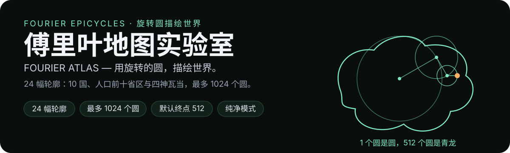
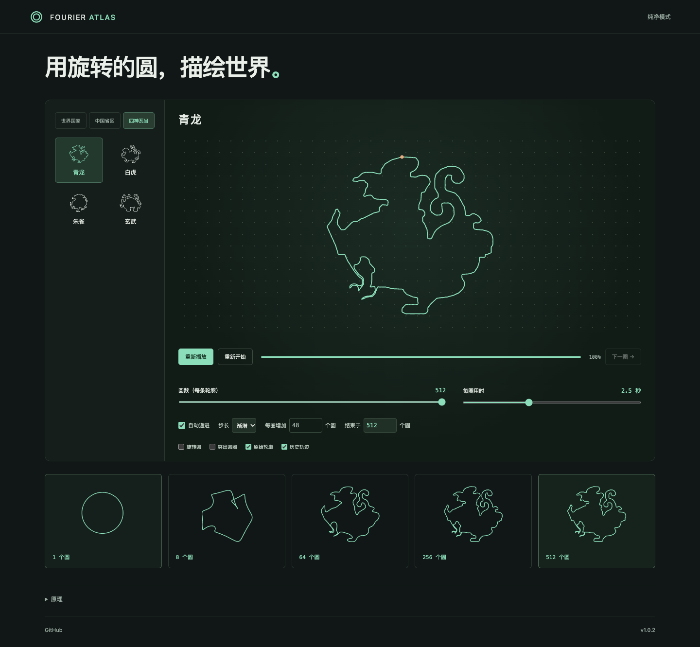
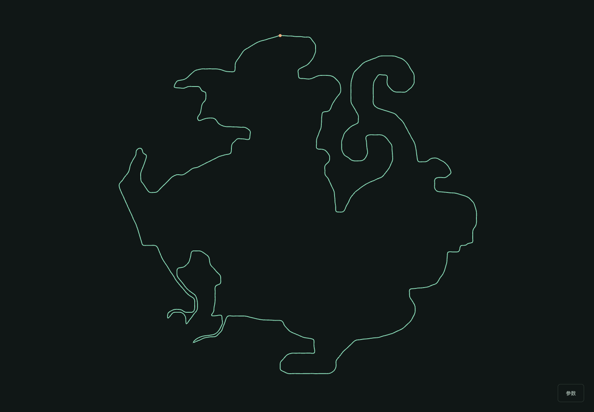

<p align="right"><a href="README.md">中文</a></p>

<p align="center">
  
</p>

<p align="center">
  <a href="https://xiaosang.cc/fourier-atlas/">▶ Live Demo</a>
  ·
  <a href="https://xiaosang.cc/fourier-atlas/pure">Clean View</a>
  ·
  <a href="https://github.com/holynova/fourier-atlas">GitHub Repository</a>
</p>

Draw maps and ancient tile motifs with rotating Fourier epicycles: pick an outline and watch the pen's path morph from a circle into China, Guangdong, or the Azure Dragon as the circle count grows from 1 to 512.

## Screenshots

<p align="center">
  
  
</p>

## 24 Outlines

- **10 countries**: China, USA, Canada, Brazil, UK, France, Russia, India, Japan, Australia.
- **10 Chinese provinces**: 广东 Guangdong, 山东 Shandong, 河南 Henan, 江苏 Jiangsu, 四川 Sichuan, 河北 Hebei, 浙江 Zhejiang, 湖南 Hunan, 安徽 Anhui, 湖北 Hubei (top ten by 2024 year-end permanent population).
- **4 guardian tile motifs**: 青龙 Azure Dragon, 白虎 White Tiger, 朱雀 Vermilion Bird, 玄武 Black Tortoise — traced and simplified from Shanghai Museum guide images; each motif is drawn as a single outer contour, not an exact replica of the artifact.

## Controls

- **Circle count**: slider from 1–1024 circles; seconds per revolution adjustable; auto-advance adds 48 circles per round by default, ending at 512 (adaptive or fixed step).
- **Display**: four toggles — epicycles, highlight circle, original contour, and history trails; the trails overlay each round's pen path.
- **Stage comparison**: the same outline drawn with 1 / 8 / 64 / 256 / 512 circles side by side, showing how circle count relates to accuracy.
- **Clean view** (`/pure`): just the drawing, with the parameter panel collapsed — for quietly watching one outline finish.

## How It Works

Each outline is sampled at 2048 equal-arclength points, transformed with a discrete Fourier transform, and reduced to the DC term plus the 1024 largest-magnitude terms; every term becomes a rotating circle (radius = magnitude, speed = frequency), chained centre to rim, with the pen on the last circle tracing the outline over time. More circles means a closer fit to the original outline.

## Data

- Country and province boundaries: Natural Earth Admin 0 (110m) and Admin 1 (50m); the China outline includes Taiwan, stitched in the same projection.
- Province populations: 2024 year-end permanent population (Jiangsu Statistical Yearbook 2025).
- Guardian tiles: traced and simplified from Shanghai Museum guide images (《上博导赏丨上海博物馆藏文物之动物篇》, a guide to animals in the museum's collection).

## Run Locally

Buildless — the production files are all in `dist/`. Just serve them:

```bash
npm ci
npm run dev      # python3 -m http.server 4173 --directory dist
# Open http://localhost:4173
```

Check and regenerate the data:

```bash
npm run check    # node --check dist/app.js
python3 prepare_data.py   # needs NumPy; regenerates the Fourier coefficients from GeoJSON
```

## Tech

- Vanilla JS + Canvas, no framework, no build step; coefficients are precomputed in `dist/countries.js` (~2.4 MB).
- The draw loop recomputes progressively as the circle count grows; trail overlays use fading history frames.

```
dist/                   Production build (buildless static site)
dist/index.html         Main view
dist/pure.html          Clean view
dist/app.js             Epicycle drawing and interaction
dist/countries.js       Fourier coefficients for 24 outlines (~2.4 MB)
prepare_data.py         Regenerates coefficients from GeoJSON with NumPy
countries-source.geojson / provinces-source.geojson  Source geographic data
artwork-contours.json   Guardian tile contours
references/tiles/       Guardian tile reference SVGs
```

Current release: v1.0.3.
