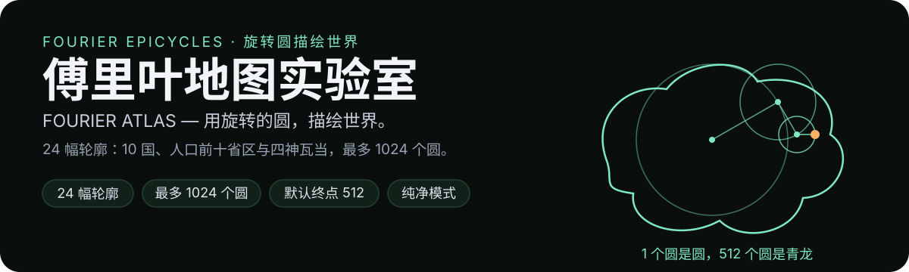
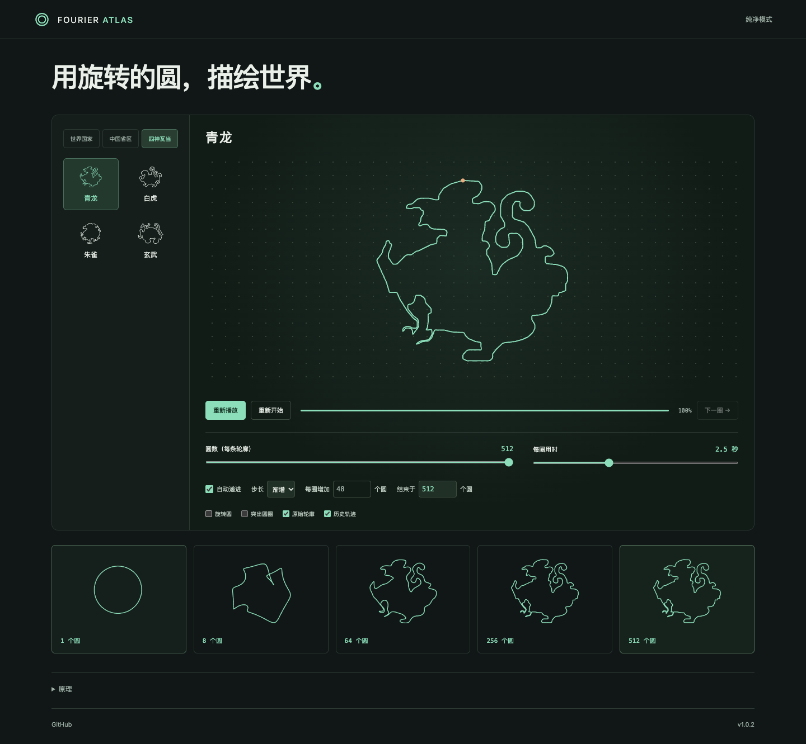
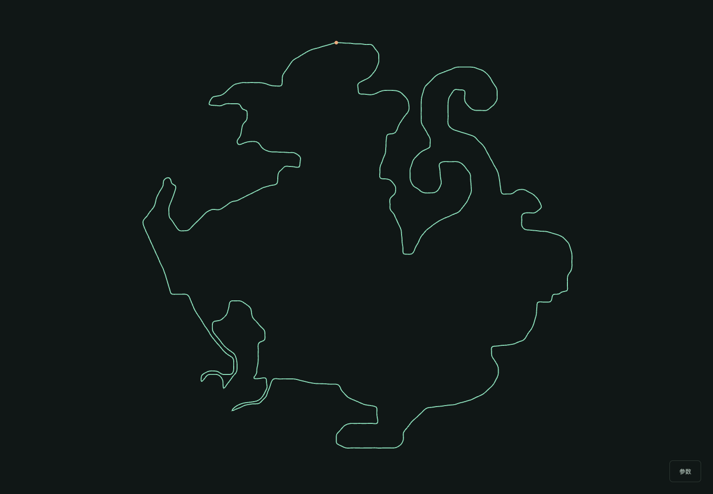

<p align="right"><a href="README.en.md">English</a></p>

<p align="center">
  
</p>

<p align="center">
  <a href="https://xiaosang.cc/fourier-atlas/">▶ 在线体验</a>
  ·
  <a href="https://xiaosang.cc/fourier-atlas/pure">纯净模式</a>
  ·
  <a href="https://github.com/holynova/fourier-atlas">GitHub 仓库</a>
</p>

用一串旋转的圆描绘地图与四神瓦当纹样：选一幅轮廓，看圆数从 1 增加到 512，笔尖画出的线条从圆圈渐渐变成中国、广东或青龙。

## 截图

<p align="center">
  
  
</p>

## 画什么

- **世界国家 10**：中国、美国、加拿大、巴西、英国、法国、俄罗斯、印度、日本、澳大利亚。
- **中国省区 10**：广东、山东、河南、江苏、四川、河北、浙江、湖南、安徽、湖北（2024 年末常住人口前十）。
- **四神瓦当 4**：青龙、白虎、朱雀、玄武——依据上海博物馆公开导赏图描摹并简化，每个纹样只绘制一条外轮廓，并非文物的精确复刻。

## 怎么玩

- **圆数**：滑杆调 1–1024 个圆；每圈用时可调；自动递进默认每圈增加 48 个圆、结束于 512（步长可选渐增或固定）。
- **显示**：旋转圆、突出圆圈、原始轮廓、历史轨迹四项开关；历史轨迹把每一圈的笔尖路径叠加保留。
- **阶段对比**：下方并排 1 / 8 / 64 / 256 / 512 个圆画出的同一轮廓，直观看到圆数与精度的关系。
- **纯净模式**（`/pure`）：只保留画面，参数默认收起，适合静静看一条轮廓画完。

## 原理

每条轮廓先沿等弧长采 2048 个点，做离散傅里叶变换，保留直流项与幅值最大的 1024 项；每一项对应一个旋转圆（半径 = 幅值，转速 = 频率），圆心首尾相连，最后一个圆上的笔尖随时间画出轮廓。圆越多，画出的线越贴合原轮廓。

## 数据来源

- 国家与省区边界：Natural Earth Admin 0（110m）与 Admin 1（50m）；中国轮廓含台湾同投影拼接。
- 省区人口：2024 年末常住人口（江苏省统计年鉴 2025）。
- 四神瓦当：上海博物馆公开导赏图（《上博导赏丨上海博物馆藏文物之动物篇》）描摹简化。

## 本地运行

零构建，生产资源都在 `dist/`，直接起静态服务器：

```bash
npm ci
npm run dev      # python3 -m http.server 4173 --directory dist
# 打开 http://localhost:4173
```

检查与重新生成数据：

```bash
npm run check    # node --check dist/app.js
python3 prepare_data.py   # 需 NumPy，从 GeoJSON 重新生成傅里叶系数
```

## 技术

- 纯 JS + Canvas，无框架、无构建步骤；系数预计算在 `dist/countries.js`（约 2.4MB）。
- 绘制循环按圆数渐进重算，轨迹叠加用淡出历史帧实现。

```
dist/                   发布版（零构建静态站）
dist/index.html         主界面
dist/pure.html          纯净模式
dist/app.js             旋转圆绘制与交互
dist/countries.js       24 幅轮廓的傅里叶系数（约 2.4MB）
prepare_data.py         用 NumPy 从 GeoJSON 重新生成系数
countries-source.geojson / provinces-source.geojson  原始地理数据
artwork-contours.json   四神瓦当轮廓
references/tiles/       四神瓦当参考 SVG
```

当前发布版 v1.0.3。
